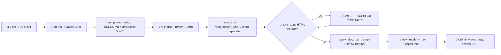
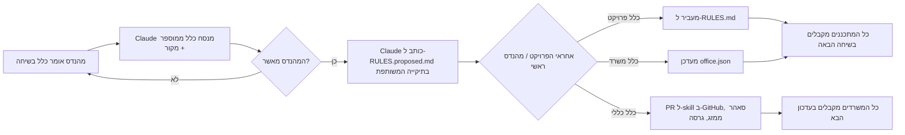
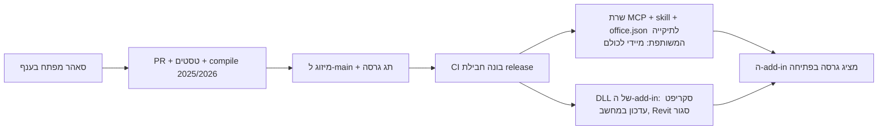

# תוכנית הטמעה והפצה — "סוכן התכנון" (Design by Example) בטופז ואחר כך בחברות נוספות

**תאריך:** 2026-11-10 · **בעלים:** סאהר · **מצב:** טיוטה לאישור

**תקציר:** הכלי עובד היום על מחשב אחד (סאהר) ועבר ביום אחד סבב ביקורת של מהנדסת (עביר) על קומה אמיתית. המסמך הזה
מגדיר איך הופכים אותו מכלי אישי ל"כוח" של המשרד: ארכיטקטורה של ידע משותף (כללים שנלמדים אצל מהנדס אחד מגיעים לכולם
אחרי אישור), תהליכי עבודה יומיים, מסלול הפצה בארבעה שלבים עם שערי מעבר, עלויות, תפקידים וסיכונים. ההפצה לחברות אחרות
היא השלב הרביעי של אותה תוכנית, לא פרויקט נפרד: כל מה שבונים לטופז נבנה כך שמשרד אחר יכול לקלוט אותו בלי שינוי קוד.
המסמכים `DESIGN.md` (ארכיטקטורת המנוע) ו-`docs/deployment.md` (פריסת IT) נשארים בתוקף; זה מסמך העל שמחבר ביניהם.

---

## 1. מה יש היום ומה חסר

| רכיב | היום | מה חסר להטמעה |
| --- | --- | --- |
| מנוע תכנון-לפי-דוגמה + 60 כלי MCP ל-Revit | עובד, 26 טסטים, קומה 03 של KYM-EL-101-5 תוכננה ונבדקה | אישור עביר ל-233 תיקוני גובה; קומות B-F |
| כללי המשרד (office.json) וכללי פרויקט (RULES.md) | קבצים מקומיים במחשב אחד | מיקום משותף + תהליך אישור כלל |
| ה-skill (ידע כללי: חדרים, גבהים, hosting) | בריפו, 4 PRs פתוחים עם כללי עביר | מיזוג, בעלות, גרסאות |
| התקנה | סקריפט מפתח (dotnet + npm על כל מחשב) | חבילת release מוכנה, עדכון מרכזי |
| רישוי | חשבון אחד | מושבי Claude Team לכל מתכנן |
| מדידה | חוברות השוואה ידניות (compare02/03) | מדדים אוטומטיים לכל ריצה |

## 2. עיצוב (DESIGN) — שכבת הידע המשותף

### 2.1 עיקרון
הכלי לומד **רק דרך קבצים**. הערה בשיחה משפיעה על אותה שיחה בלבד. לכן "למידה משותפת" = הקבצים שהכלי כותב יושבים
במקום שכולם קוראים ממנו, ועוברים סינון אנושי אחד לפני שהם מחייבים.

### 2.2 ארבע שכבות ידע, מהכללי לפרטי
| שכבה | קובץ | מי כותב | מי מאשר | איפה יושב |
| --- | --- | --- | --- | --- |
| **ידע הנדסי כללי** (חדרים, hosting, גבהים ברירת מחדל) | `skill/design-by-example/` | Claude מציע ב-PR, סאהר/מהנדס ראשי עורך | סאהר (בעל ה-skill) | GitHub, גרסה מתויגת |
| **כללי המשרד** (משפחות, גבהים של טופז, worksets, אוצר מילים) | `office.json` | Claude מציע, מהנדס ראשי מאשר | מהנדס/ת ראשי/ת (עביר) | תיקייה משותפת `\\server\RevitClaude\office\` |
| **כללי פרויקט** (לקוח, מסמכי הנחיות, חריגים) | `Projects\<פרויקט>\RULES.md` | Claude כותב ל-`RULES.proposed.md` אחרי אישור המהנדס בשיחה | אחראי הפרויקט מעביר ל-RULES.md | תיקייה משותפת `\\server\RevitClaude\Projects\<פרויקט>\` |
| **זיכרון אישי** (העדפות, סגנון, מה המהנדס ביקש בעבר) | זיכרון Claude Code של המשתמש | Claude | המשתמש | מקומי, לא משותף |

### 2.3 שינויי קוד נדרשים (קטנים)
1. `projectsFolder` ותיקיית `office.json` ניתנות להגדרה (משתנה סביבה `REVITCLAUDE_ROOT`), ברירת מחדל נשארת `Documents\RevitClaude`.
2. `save_project_rules` כותב ל-`RULES.proposed.md` (עם שם המציע, תאריך, מקור) כשהתיקייה משותפת; `RULES.md` נשאר לקריאה בלבד מצד הכלי.
3. דוח ריצה אוטומטי (`run-report.json`) אחרי כל `apply_electrical_design`: כיסוי, הוזז/נשמט, שגיאות review, זמן. המדדים של סעיף 6 נגזרים ממנו.
4. חבילת release: GitHub Actions בונה add-in ל-2025/2026 + שרת בנוי + skill + office.json לדוגמה; גרסה מתויגת.

### 2.4 מומחים תחומיים (סשן Claude לכל תחום)
סאהר מנהל סשן Claude קבוע לכל תחום הנדסי, וכל פרויקט חדש נלמד בסשן של התחום שלו. כל מומחה מחזיק מסמך ידע תחומי
ב-`<hub>\knowledge\domains\<domain>.he.md` (יחידות חוזרות, עוגנים, תקנים, שאלות פתיחה לפרויקט), וכל לקח שאושר
בפרויקט מתווסף אליו. התחומים: בנייני מגורים, בתי חולים, בתי ספר, שכונות, רכבות, מנהרות, תחנות רכבת. מסמך תחום שהתייצב
הופך ל-adapter או לקובץ reference ב-skill (שכבה 1), כך שהידע מגיע גם לחברות אחרות.

### 2.5 מה נשאר מקומי בכוונה
ה-DLL של ה-add-in (Revit נועל אותו), snapshots ו-proposals (גדולים, אישיים לריצה), תמלילי Claude Code.

## 3. תהליכי עבודה (WORKFLOWS)

### 3.1 יום עבודה של מתכנן

### 3.2 למידה משותפת (כלל חדש)

### 3.3 עדכון הכלי

## 4. מסלול ההטמעה — ארבעה שלבים עם שערים

### שלב 0 — סגירת הפיילוט עם עביר (שבוע 1)
- מיזוג PRs #3/#4/#5 (כללי עביר ב-skill), התקנה מחדש אצל סאהר.
- אישור עביר ל-233 תיקוני הגובה בקומה 02, ביצוע, קומה 03, דירות B-F.
- **שער:** עביר מקבלת קומה שלמה עם 15 דקות תיקונים ידניים לכל היותר; 0 שגיאות review מסוג "מחוץ לחדר"/"בלי מפלס".

### שלב 1 — שני מתכננים בטופז (שבועות 2-5)
- עביר + מתכנן/ת נוסף/ת. Claude Team (2-3 מושבים). התקנה ידנית (20 דקות למחשב).
- תיקייה משותפת לכללים (סעיף 2.2) + `REVITCLAUDE_ROOT`. RULES.proposed.md בפעולה.
- פרויקט שני, אדריכל אחר (הכללה של שמות משפחות וחדרים).
- מדידה שבועית (סעיף 6). סדנה של 90 דקות (המצגת "AI in Revit" קיימת).
- **שער:** 3 קומות אמיתיות בשני פרויקטים; המתכננים ממשיכים להשתמש מרצונם; עלות לחודש למשתמש ידועה.

### שלב 2 — מחלקת החשמל בטופז (חודשים 2-3)
- 10-15 משתמשים. חבילת release + התקנה שקטה (`docs/deployment.md`). managed-settings: `send_code_to_revit` חסום, אין Sync.
- חלוץ/ה בכל צוות כקו תמיכה ראשון. כללי משרד מלאים ב-office.json.
- מדדים אוטומטיים מ-run-report.json לדשבורד פשוט (Excel/Power BI).
- **שער:** פחות מקריאת תמיכה אחת למשתמש לשבוע; עדכון גרסה אחד הגיע לכולם אוטומטית; חיסכון זמן נמדד של 40% לפחות בקומה טיפוסית.

### שלב 3 — כל טופז + הרחבת תחומים (חודשים 4-6)
- Revit 2026, מתכנני מ"א/אינסטלציה עם adapters חדשים לפי `DESIGN.md §4.3` (כל adapter: טסטים סינתטיים, מודל אחד, פריסה).
- Civil 3D לרכבות (NofIt) כ-adapter לינארי.
- **שער:** שני תחומים נוספים עם פיילוט שהתקבל.

### שלב 4 — חברות אחרות (מחודש 6)
- **מודל מוצר:** ריפו ציבורי (MIT) = הליבה; הידע של טופז (office.json, RULES, מודלים) לעולם לא בריפו.
- **קליטת משרד חדש** (`DESIGN.md §5`, ללא קוד): התקנה 30 דקות, office.json שעה, פרויקט ראשון, פיילוט קומה, go-live. סדנה חצי יום.
- **מה טופז מוכרת:** הטמעה, סדנה, כיול office.json, תמיכה ו-skill מתוחזק; לא תוכנה. רישוי Claude נשאר של כל חברה (Team/Enterprise/Foundry לפי מדיניות ה-IT שלה).
- **מסלול API** (הכלי כאפליקציה עצמאית בלי Claude Code): נבנה רק אם 5 משתמשים ומעלה במשרד אחד או דרישת IT. מתואר ב-`docs/deployment.md`.
- **שער:** חברה ראשונה עם קומה מאושרת על המודלים שלה, ללא שינוי קוד.

## 5. תפקידים
| תפקיד | מי | אחריות |
| --- | --- | --- |
| בעל המוצר וה-skill | סאהר | פיתוח, מיזוגים, גרסאות, הפצה |
| מהנדס/ת ראשי/ת | עביר | אישור כללי משרד, קבלת תוצאות, הדרכה מקצועית |
| אחראי פרויקט | לפי פרויקט | RULES.proposed ל-RULES.md |
| חלוץ צוות | אחד לצוות | תמיכה ראשונה, איסוף הערות |
| IT | טופז IT | מושבים, managed-settings, תיקייה משותפת, התקנה שקטה |

## 6. מדדים (לכל ריצה, מ-run-report.json)
1. **כיסוי:** נקודות עם כלל / נקודות בדוגמה (יעד 90% ומעלה).
2. **איכות מיקום:** הוצב / הוזז / נשמט; מרחק הזזה ממוצע; היסטוגרמת סיבות (יעד נשמט 5% לכל היותר).
3. **עמידה בכללים:** שגיאות ואזהרות review לפני/אחרי (יעד 0 שגיאות).
4. **הסכמה עם המהנדס:** הפרש ספירות Claude מול ידני לכל תפקיד וסוג חדר (יעד ±10%).
5. **זמן:** snapshot, חלק offline, הצבה לדירה, זמן ביקורת מהנדס לקומה (יעד 15 דקות לכל היותר).
6. **עלות:** טוקנים/ש"ח לקומה (נמדד ב-Team dashboard או ב-API usage).

## 7. עלויות (דולר, לפני מע"מ, מחירים נבדקו 2026-11-10)
| פריט | שלב 1 (3 משתמשים) | שלב 2 (15) | הערה |
| --- | --- | --- | --- |
| Claude Team סטנדרט | 60-75 לחודש | 300-375 | 20$ שנתי / 25$ חודשי למושב |
| Claude Team פרימיום (מתכננים כבדים) | 100-125 למושב | לפי צורך | מכסה גבוהה; למדוד בשלב 1 מי צריך |
| פיתוח (סעיף 2.3) | כשבועיים של סאהר | חבילת release + CI: שבוע | חד-פעמי |
| IT | תיקייה משותפת, 2-3 התקנות | Intune/GPO, חתימת קוד | חתימת קוד: תעודה של המשרד |
| חלופה: API לפי טוקנים | Opus 5.5: 4$/20$ למיליון | | רק במסלול האפליקציה העצמאית |

## 8. סיכונים ומענה
| סיכון | מענה |
| --- | --- |
| Claude מסנכרן מודל ענן (ACC) | כלל קשיח ב-CLAUDE.md + managed-settings; עבודה על עותק מקומי בפיילוט |
| כללים סותרים בין מתכננים | RULES.proposed.md + מאשר אנושי אחד לכל שכבה |
| מידע לקוח יוצא מהמשרד | Team/Enterprise בלבד (ללא אימון, 30 יום); אופציית Foundry; snapshot ניתן להשחרה |
| עותקי סכסוך ב-SharePoint מסונכרן | תיקיית רשת או קובץ proposed נפרד לכל משתמש |
| תלות באדם אחד (סאהר) | תיעוד, CI, release מתויג, חלוץ בכל צוות |
| Revit נועל DLL | עדכון DLL רק כש-Revit סגור, סקריפט בודק |
| עלות טוקנים לא צפויה | ספירה לכל ריצה ב-run-report; מגבלות הוצאה ב-Team |

## 9. מה צריך מסאהר עכשיו (סדר)
1. אישור המסמך הזה (או הערות).
2. מיזוג PRs #3/#4/#5 והתקנה מחדש.
3. החלטת IT: Claude Team (כמה מושבים) ותיקייה משותפת (רשת או SharePoint).
4. שם המתכנן/ת השני/ה לשלב 1.
